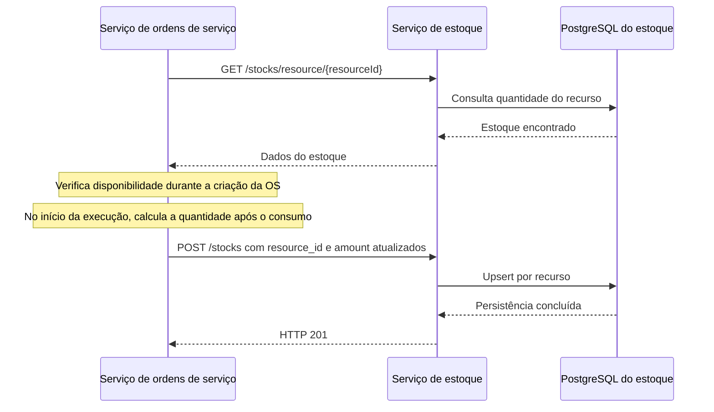

# Microsserviço de atualização de estoque

Microsserviço da arquitetura do sistema de ordens de serviço automotivas. Ele mantém o estoque e o cadastro dos recursos utilizados nos serviços, expondo uma API HTTP para consulta e atualização pelo serviço principal de ordens de serviço.

Este repositório corresponde a um dos três serviços criados para a arquitetura distribuída. Seu escopo é o domínio de estoque e recursos, persistido em uma base PostgreSQL própria.

## Objetivos e responsabilidades

- Manter a quantidade disponível de cada recurso.
- Consultar a quantidade de estoque durante a criação de uma ordem de serviço.
- Receber a nova quantidade quando uma etapa da ordem de serviço efetivar o consumo de recursos.
- Disponibilizar operações de cadastro e consulta de recursos, como nome, tipo, custo e unidade.
- Persistir os dados localmente neste serviço, sem compartilhar tabelas com o serviço principal.

O serviço não cria nem coordena uma ordem de serviço. O serviço principal conduz esse fluxo e chama a API de estoque nos momentos necessários.

## Contexto de microsserviços e Saga

### Comunicação entre serviços

A comunicação M2M (Machine-to-Machine) em microsserviços é a troca de dados e a autenticação direta entre serviços de backend, sem a intervenção ou o contexto de um usuário final. Neste projeto, o serviço principal integra-se ao serviço de estoque por requisições HTTP à API REST.

Essa integração permite que cada serviço mantenha seu próprio limite de responsabilidade e que o serviço principal consulte ou atualize o estoque por meio de um contrato HTTP, sem acessar diretamente o banco de dados do estoque.

### Participação no fluxo de Saga

Uma Saga organiza uma operação de negócio distribuída em etapas locais realizadas por diferentes serviços. Cada serviço confirma suas próprias alterações no banco local; o fluxo como um todo é conduzido por uma sequência de chamadas entre serviços.

No contexto informado para este sistema, o serviço de ordens de serviço conduz o processo e o serviço de estoque participa como responsável por consultar e atualizar seu domínio. A persistência de estoque é uma operação local deste microsserviço. A integração HTTP entre as etapas e a separação das bases são conceitos de microsserviços aplicados ao fluxo.

O fluxo de criação e execução da ordem é:



O `POST /stocks` recebe a quantidade atualizada e a grava associada ao recurso; o serviço não recebe uma instrução de decremento para calcular a diferença. O cálculo da quantidade após o consumo pertence ao fluxo que chama a API.

O código deste serviço implementa as operações locais de estoque e os endpoints de integração descritos acima. A coordenação integral da Saga — incluindo decisões sobre o estado da ordem após uma falha em outra etapa — pertence ao serviço que conduz o processo e não é implementada neste repositório.

## Arquitetura e módulos

A aplicação foi construída com NestJS, TypeORM e PostgreSQL. Os módulos são organizados por responsabilidade:

| Módulo | Responsabilidade |
| --- | --- |
| `stock` | Controladores, serviço de domínio, entidade e contratos HTTP para consultar e atualizar quantidades. |
| `resources` | Cadastro, consulta, atualização e remoção dos recursos associados ao estoque. |
| `auth` | Proteção global das rotas com JWT; libera explicitamente as rotas marcadas como públicas. |
| `health` | Endpoint público usado para verificar a disponibilidade da aplicação. |
| `fallback` | Resposta HTTP 404 para rotas não mapeadas. |

O `AppModule` registra os módulos, a configuração global e a conexão TypeORM. A camada de controladores trata as requisições e respostas HTTP; os serviços encapsulam o acesso aos repositórios; entidades e modelos descrevem a persistência e os contratos de dados.

### Modelo de dados

O banco possui duas tabelas principais:

- `tb_resource`: identifica o recurso e armazena nome, tipo, custo e unidade.
- `tb_stock`: armazena a quantidade (`amount`) e referencia um recurso por `resource_id`.

Cada recurso tem no máximo um registro de estoque. A relação é obrigatória, e a chave estrangeira define remoção em cascata do estoque quando o recurso é removido. As migrações criam as tabelas e incluem dados iniciais de exemplo.

Os tipos de recurso disponíveis são `P` (peças) e `S` (suprimentos). As unidades disponíveis são `L` (litros), `ML` (mililitros) e `U` (unidades).

## API HTTP

A documentação interativa do Swagger fica disponível em `/api`. A aplicação usa a porta `3002` por padrão, configurável pela variável `PORT`.

Todas as rotas abaixo, exceto `GET /health`, exigem o cabeçalho:

```http
Authorization: Bearer <jwt>
```

O token precisa ser assinado com o segredo configurado em `JWT_SECRET` e conter `ADMIN` em `roles`.

### Estoque

| Método e rota | Descrição | Resposta de sucesso |
| --- | --- | --- |
| `POST /stocks` | Cria o registro ou substitui a quantidade do recurso informado. | `201` |
| `GET /stocks` | Lista os registros de estoque com os dados do recurso. | `200` |
| `GET /stocks/{id}` | Consulta pelo identificador do registro de estoque. | `200` |
| `GET /stocks/resource/{id}` | Consulta pelo identificador do recurso; usado na verificação de disponibilidade. | `200` |
| `PUT /stocks/{id}` | Atualiza um registro de estoque existente. | `201` |
| `DELETE /stocks/{id}` | Remove um registro de estoque. | `200` |

Exemplo de atualização recebida pelo serviço:

```http
POST /stocks
Content-Type: application/json
Authorization: Bearer <jwt>
```

```json
{
  "resource_id": 2,
  "amount": 49
}
```

O `POST` usa `upsert` com base no recurso: se já houver estoque para o `resource_id`, a quantidade é atualizada; caso contrário, um registro é criado. Isso permite que o serviço principal envie a quantidade corrente por recurso através do mesmo contrato.

A resposta de consulta de estoque contém:

```json
{
  "stock_id": 2,
  "resource_name": "Filtro de Óleo",
  "resource_id": 2,
  "stock_amount": 49,
  "resource_unit": "U"
}
```

### Recursos

| Método e rota | Descrição | Resposta de sucesso |
| --- | --- | --- |
| `POST /resources` | Cadastra um recurso. | `201` |
| `GET /resources` | Lista os recursos cadastrados. | `200` |
| `GET /resources/{id}` | Consulta um recurso por identificador. | `200` |
| `PUT /resources/{id}` | Atualiza um recurso existente. | `201` |
| `DELETE /resources/{id}` | Remove um recurso e seu estoque relacionado. | `200` |

Exemplo de cadastro:

```json
{
  "name": "Filtro de Óleo",
  "type": "P",
  "cost": 25,
  "unit": "U"
}
```

### Saúde

`GET /health` é público e responde `200` quando a aplicação está ativa. Ele também é usado como verificação de disponibilidade no manifesto de deployment.

## Validação e segurança

- Um `ValidationPipe` global transforma os dados recebidos e aplica as regras declaradas nos modelos.
- Quantidade e identificador do recurso no contrato de estoque são inteiros.
- Cadastro de recursos valida nome, tipo, custo e unidade.
- O guard de autenticação verifica o JWT e exige a role `ADMIN` nas rotas protegidas.
- A rota de saúde é explicitamente pública.

## Persistência e configuração

O PostgreSQL é acessado via TypeORM. As credenciais e endereço são configurados pelas variáveis:

| Variável | Finalidade |
| --- | --- |
| `DB_HOST` | Endereço do PostgreSQL. |
| `DB_PORT` | Porta do PostgreSQL; padrão `5432`. |
| `DB_NAME` | Nome do banco de dados. |
| `DB_USER` | Usuário do banco. |
| `DB_PASSWORD` | Senha do banco. |
| `JWT_SECRET` | Segredo usado para validar tokens JWT. |
| `PORT` | Porta HTTP da aplicação; padrão `3002`. |

As migrações são executadas na inicialização (`migrationsRun: true`) e a sincronização automática de esquema do TypeORM fica desativada. As migrações versionadas definem as tabelas e a carga inicial de recursos e quantidades de exemplo.

## Execução local

Requisitos: Node.js compatível com a imagem de execução do projeto e PostgreSQL acessível.

1. Instale as dependências:

   ```bash
   npm ci
   ```

2. Configure as variáveis de banco e `JWT_SECRET` no ambiente ou em um arquivo `.env` na raiz do projeto.
3. Inicie em modo de desenvolvimento:

   ```bash
   npm run dev
   ```

   A aplicação inicia em `http://localhost:3002` por padrão.

Para compilar e executar em modo de produção:

```bash
npm run build
npm run start:prod
```

## Infraestrutura

O repositório inclui uma imagem Docker multi-stage e arquivos Terraform para deployment em Kubernetes. A definição Kubernetes configura uma réplica, expõe a porta `3002` por um serviço `NodePort` (porta de nó `30002`) e usa `GET /health` como probe de disponibilidade. As variáveis de conexão com o banco são injetadas no container; os valores sensíveis de autenticação são referenciados a partir de Secrets do Kubernetes.

Também há uma composição Docker com serviços de aplicação e PostgreSQL para execução containerizada. O serviço mantém dados do banco em volume nomeado.

## Testes e comandos úteis

```bash
npm test              # executa os testes Jest
npm run test:cov      # executa os testes com cobertura
npm run lint          # verifica estilo e regras ESLint
npm run tsc           # verifica tipos TypeScript
npm run build         # compila a aplicação NestJS
```

Os testes existentes cobrem controladores e serviços dos módulos de estoque e recursos.
